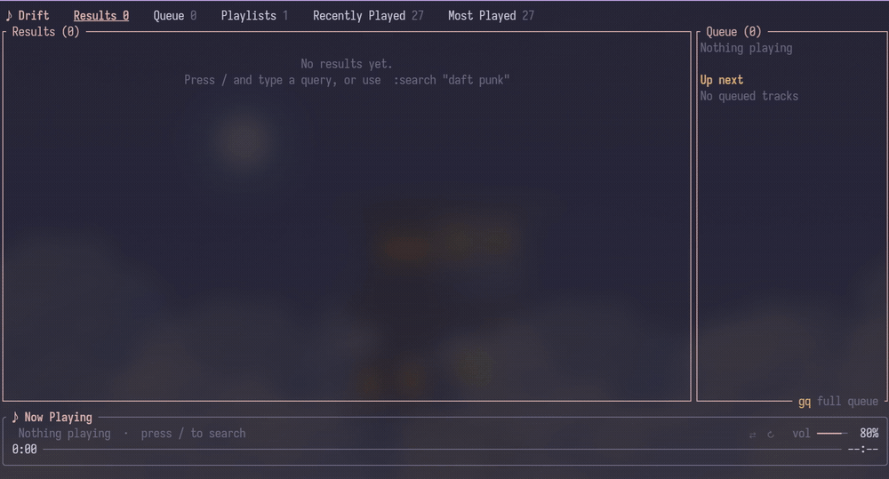

<div align="center">

# Drift

### A YouTube Music player for your terminal, with Vim keybinds.

Search, queue and play music with no account, no login and no browser.

[](https://github.com/socatlolmeow/drift/stargazers)
[](https://github.com/socatlolmeow/drift/actions/workflows/rust.yml)
[](LICENSE)




</div>

---

## Table of contents

- [Features](#features)
- [Installation](#installation)
  - [Arch Linux (AUR)](#arch-linux-aur)
  - [Install script](#install-script)
  - [From source](#from-source)
  - [Nix](#nix)
  - [Installing mpv and yt-dlp manually](#installing-mpv-and-yt-dlp-manually)
- [Usage](#usage)
- [Keybinds](#keybinds)
- [Commands](#commands)
- [Lyrics](#lyrics)
- [Configuration](#configuration)
  - [Streaming or downloading](#streaming-or-downloading)
  - [Discord rich presence](#discord-rich-presence)
  - [Custom keys](#custom-keys)
  - [Environment variables](#environment-variables)
- [Troubleshooting](#troubleshooting)
- [Contributing](#contributing)
- [License](#license)

---

## Features

- Vim-style keybinds: `j`/`k`, `gg`/`ge`, counts like `5j`, and `:` for the command line
- Synced lyrics in a side panel or fullscreen, with the current line filled in as it's sung
- Queue and playlists. Build a queue, save and reorder playlists, or import any YouTube / YouTube Music playlist by URL
- Listening history: Recently Played and Most Played tabs, with persistent play counts
- Discovery: `ga` for an artist's songs, `gs` for similar songs, `gb` for the album, and `:album` / `:playlist` to search for albums and playlists
- A song menu (`G`) to play a song, queue it, add it to a playlist, jump to the artist or see its info
- A command palette (`:search`, `:seek`, `:vol`, `:import` and more) with completion and history
- Your queue and position are restored the next time you start Drift
- Media keys and `playerctl` on Linux (MPRIS), plus optional Discord rich presence
- One TOML file for volume, seek step, shuffle/repeat defaults, accent color and custom keybinds

## Installation

Drift needs [mpv](https://mpv.io/) for playback and [yt-dlp](https://github.com/yt-dlp/yt-dlp) to get the audio streams. Run `drift --check` at any time to see if both are installed.

### Arch Linux (AUR)

```bash
yay -S driftmusic-git
```

Any AUR helper works. You can also build it by hand:

```bash
git clone https://aur.archlinux.org/driftmusic-git.git
cd driftmusic-git
makepkg -si
```

`mpv` and `yt-dlp` are pulled in automatically.

### Install script

Works on Arch, Debian/Ubuntu, Fedora, openSUSE, Void, Alpine and Gentoo. It installs the dependencies and builds Drift with cargo.

```bash
git clone https://github.com/socatlolmeow/drift.git
cd drift
./install.sh
```

### From source

Install the dependencies and [Rust](https://rustup.rs/), then:

```bash
git clone https://github.com/socatlolmeow/drift.git
cd drift
cargo install --path .
```

This puts `drift` in `~/.cargo/bin/`, which is on your `$PATH` if you installed Rust with rustup.

### Nix

The repo has a flake that puts `mpv` and `yt-dlp` on Drift's `PATH` for you:

```bash
nix run github:socatlolmeow/drift
```

### Installing mpv and yt-dlp manually

| Platform | Command |
| --- | --- |
| Debian / Ubuntu | `sudo apt install mpv` and `pipx install yt-dlp` |
| macOS | `brew install mpv yt-dlp` |
| Arch | `sudo pacman -S mpv yt-dlp` |
| Windows | `winget install mpv.net yt-dlp.yt-dlp` or `scoop install mpv yt-dlp` |

## Usage

```bash
drift                    # start the player
drift "daft punk"        # start with a search
drift --check            # check that mpv and yt-dlp are installed
drift --help
drift --version
```

Press `/` to search, `Enter` to play, `a` to add a song to the queue and `?` for the full list of keybinds. Inside the player, `:help` lists the commands.

## Keybinds

These are the defaults. You can change them, see [Custom keys](#custom-keys).

| Key | Action |
| --- | --- |
| `j` `k` / `↓` `↑` | move (counts work: `5j`) |
| `gg` `ge` | jump to top / bottom (`5gg` goes to row 5) |
| `Tab` `Shift-Tab` | cycle Results / Queue / Playlists |
| `gr` `gq` `gp` | jump to Results / Queue / Playlists |
| `Enter` | play the selected song |
| `Space` | pause / resume |
| `n` `N` | next / previous track |
| `h` `l` / `←` `→` | seek back / forward (counts: `6l`) |
| `+` `-` | volume up / down |
| `s` `r` | toggle shuffle / cycle repeat |
| `a` `A` `P` | queue the song / queue all results / play all results |
| `dd` `x` | remove from queue or playlist |
| `J` `K` | move a queue or playlist item down / up |
| `G` | song menu |
| `ga` | go to the artist |
| `gs` | see similar songs |
| `gb` | go to the album |
| `gB` | save the album as a playlist |
| `L` | toggle the lyrics panel |
| `F` | fullscreen lyrics |
| `/` `:` | search / command line |
| `?` | help |
| `q` | quit |

## Commands

Press `:` to open the command line. Most commands have short aliases (`:vol`, `:sa`, `:ar` and so on).

| Command | Action |
| --- | --- |
| `:search "query"` | search YouTube Music |
| `:play [N]` | play or resume, or play row `N` |
| `:pause` `:resume` `:toggle` `:stop` | control playback |
| `:next` `:prev` | next / previous track |
| `:seek 90` `1:30` `+10` | absolute or relative seek |
| `:vol 50` `+5` | set or change the volume |
| `:shuffle` `:repeat [off\|all\|one]` | playback modes |
| `:add [N]` `:addall` `:playall` | queue results |
| `:remove [N]` `:clear` | remove from the queue / clear it |
| `:save name` `:load name` `:append name` | work with playlists |
| `:save! name` | save and overwrite an existing playlist |
| `:savealbum [name]` `:saveresults [name]` | save an album or the results directly as a playlist |
| `:addto name` `:delpl name` | add a song to / delete a playlist |
| `:import URL` | import a YouTube / YouTube Music playlist |
| `:album [query]` | open the selected song's album, or search albums |
| `:playlist query` | search YouTube Music playlists |
| `:similar` | songs similar to the selected one (also `:radio`) |
| `:artist` | songs by the selected song's artist |
| `:results` `:queue` `:playlists` | switch view |
| `:lyrics` | toggle the lyrics panel |
| `:quit` | quit |

`:save` refuses to overwrite an existing playlist. Use `:save!` to replace it or `:append` to add to the end of it.

## Lyrics

Press `L` for a side panel (needs a terminal at least 70 columns wide) or `F` for fullscreen. The current line is highlighted and fills in as it's sung. Songs without synced lyrics show plain text that you can scroll with `j`/`k`.

Lyrics come from [LRCLIB](https://lrclib.net) and are only fetched while the panel or fullscreen view is open.

## Configuration

Settings live in `config.toml` inside Drift's config directory (`~/.config/drift/` on Linux). Drift only reads the file and never rewrites it, so your comments are safe. Restart Drift after editing.

```toml
[playback]
volume = 80
shuffle = false
repeat = "off"        # off, all or one
autoplay = false
restore_session = true
seek_step = 5.0
volume_step = 5.0

[artist]
popular_first = false

[ui]
accent = "cyan"       # a color name or a hex value like "#FF8800"

[discord]
client_id = ""        # set this to enable Discord rich presence

[audio]
download = false              # false: stream songs; true: download to the cache first
download_max_minutes = 15     # with download = true, longer songs are still streamed (0 = no limit)
cookies_from_browser = ""     # e.g. "firefox" or "chrome"; passed to yt-dlp when YouTube blocks playback

[keys]
quit = "Q"
move_down = ["j", "down", "ctrl+n"]
move_up = ["k", "up", "ctrl+p"]
go_top = ["gg", "home"]
shuffle = []                  # an empty list unbinds the action
```

If you already have a `config.toml` from an older version, add the `[audio]` section by hand, since Drift never rewrites the file.

### Streaming or downloading

By default Drift streams songs, so playback starts right away, even for hour-long tracks. With `download = true` songs are cached on disk first, and the next song in the queue is fetched in the background while the current one plays.

### Discord rich presence

This is off by default.

1. Create an application at https://discord.com/developers/applications. Its name is what shows up after "Listening to".
2. Copy the Application ID into `client_id` under `[discord]` in `config.toml`.
3. Restart Drift.

Your status then shows the current song with cover art, album, a progress bar and a "Listen Along" button. If Discord isn't running, Drift keeps retrying quietly in the background.

### Custom keys

To change keys, add a `[keys]` section to `config.toml`. Each line sets an action to one key or a list of keys and replaces that action's default keys. Everything you leave out keeps its default.

```toml
[keys]
quit = "Q"
move_down = ["j", "down", "ctrl+n"]
move_up = ["k", "up", "ctrl+p"]
go_top = ["gg", "home"]
shuffle = []                  # an empty list unbinds the action
```

A key is a character (`"x"`, `"G"`, `"/"`), a name (`space`, `enter`, `esc`, `tab`, `backtab`, `backspace`, `delete`, `insert`, `home`, `end`, `pageup`, `pagedown`, `up`, `down`, `left`, `right`, `menu`, `f1` to `f12`), `ctrl+` plus a key, or a sequence like `"gg"` or `"ctrl+x g"`. Counts (`5j`) keep working on any binding. If you bind a key that is a default of another action, the other action loses it. A mistake in `[keys]` shows a message at startup and falls back to the default keys.

| Action | Default keys |
| --- | --- |
| `move_down` `move_up` | `j` `down` / `k` `up` |
| `half_page_down` `half_page_up` | `ctrl+d` / `ctrl+u` |
| `page_down` `page_up` | `ctrl+f` `pagedown` / `ctrl+b` `pageup` |
| `go_top` `go_bottom` | `gg` `home` / `ge` `end` |
| `next_view` `prev_view` | `tab` / `backtab` |
| `view_results` `view_queue` `view_playlists` | `gr` / `gq` / `gp` |
| `toggle_queue_sidebar` | `Q` |
| `activate` | `enter` |
| `pause` | `space` |
| `next` `prev` | `n` `>` / `N` `<` |
| `seek_back` `seek_forward` | `h` `left` / `l` `right` |
| `volume_up` `volume_down` | `+` `=` / `-` `_` |
| `add` `add_all` `play_all` | `a` / `A` / `P` |
| `delete` | `x` `delete` `dd` |
| `move_item_down` `move_item_up` | `J` / `K` |
| `shuffle` `repeat` | `s` / `r` |
| `menu` | `G` `menu` |
| `go_artist` `go_similar` `go_album` `save_album` | `ga` / `gs` / `gb` / `gB` |
| `lyrics_panel` `lyrics` | `L` / `F` |
| `search` `command` | `/` / `:` |
| `help` | `?` |
| `quit` | `q` |
| `back` | `backspace` `esc` |

In the Playlists tab `seek_forward` opens the selected playlist, and `seek_back` or `back` leaves it. Only the main view is remappable. Popups, the command line and fullscreen lyrics keep their own keys, and the in-app help (`?`) still lists the defaults.

### Environment variables

| Variable | What it does |
| --- | --- |
| `DRIFT_CONFIG_DIR` | where Drift keeps `config.toml` and your playlists |
| `DRIFT_STATE_DIR` | where Drift keeps the saved session |
| `DRIFT_MPV_ARGS` | extra arguments passed to mpv |

## Troubleshooting

**Drift says mpv or yt-dlp is missing.** Run `drift --check` to see which one, and install it with the table in [Installing mpv and yt-dlp manually](#installing-mpv-and-yt-dlp-manually).

**Playback fails with "Sign in to confirm you're not a bot".** YouTube wants a login. Set `cookies_from_browser` under `[audio]` to a browser you're logged into YouTube with (for example `"firefox"`), then restart Drift. Updating yt-dlp also helps, since YouTube changes things often.

**The lyrics panel doesn't show up.** It needs a terminal at least 70 columns wide. Make the window wider or use `F` for fullscreen lyrics.

**`drift: command not found`.** Make sure `~/.cargo/bin` is in your `$PATH`.

**`gb` opens the wrong album.** Drift looks albums up by album and artist name, so it can guess wrong, and the song needs album info to begin with. `:album <query>` lets you search for it yourself.

You can run several Drift windows at once. Only the first one restores and saves the session, and playlists saved from different windows are merged instead of overwritten.

## Contributing

Bug reports, ideas and pull requests are welcome. Read [CONTRIBUTING.md](CONTRIBUTING.md) before you start. To build and run the tests:

```bash
cargo build
cargo test
```

Recent changes are listed in [CHANGELOG.md](CHANGELOG.md).

## License

[Drift](https://github.com/socatlolmeow/drift) is free software, released under the [GNU General Public License version 3 or later](https://www.gnu.org/licenses/gpl-3.0.html).
